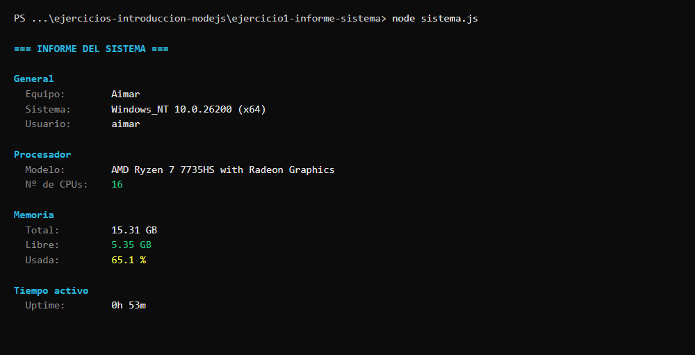
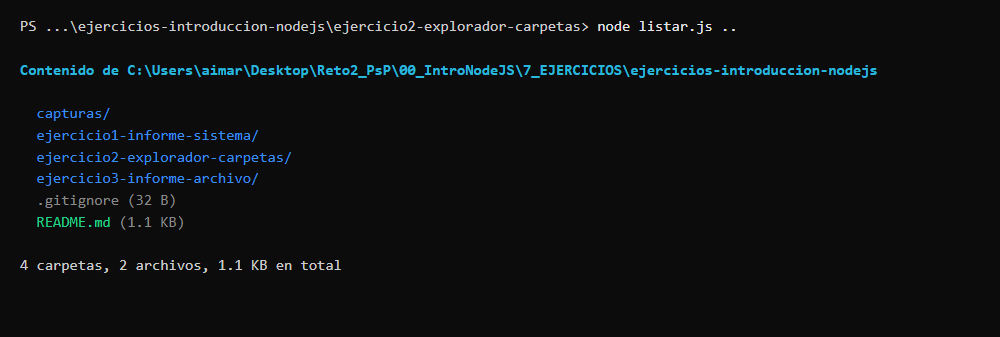
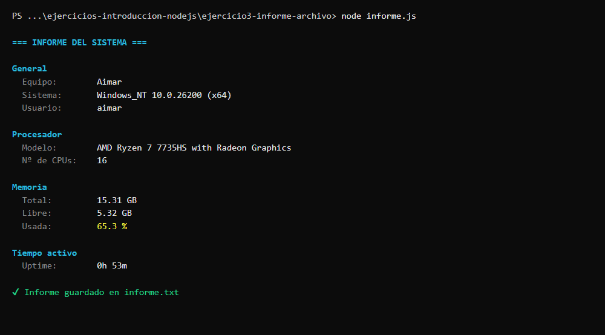

# Ejercicios: Introducción a Node.js

**Asignatura:** Programación de Servicios y Procesos

## Integrantes

- Aimar Garcia

## Ejercicio 1 · Informe del sistema

Muestra por consola un informe del equipo (nombre, sistema, usuario, procesador, memoria y tiempo activo) con colores. El porcentaje de RAM usada cambia de color según su valor.

```bash
cd ejercicio1-informe-sistema
npm install
node sistema.js
```



## Ejercicio 2 · Explorador de carpetas

Lista el contenido de una carpeta (carpetas en azul, archivos en verde con su tamaño, ocultos en gris) y muestra un resumen al final.

```bash
cd ejercicio2-explorador-carpetas
npm install
node listar.js ./ruta
```



## Ejercicio 3 · Informe a archivo con historial

Muestra el informe del sistema, lo guarda en `informe.txt` (se sobrescribe) y añade una línea a `historial.log` en cada ejecución.

```bash
cd ejercicio3-informe-archivo
npm install
node informe.js
```


